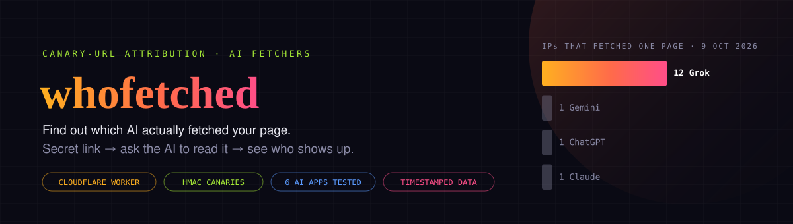
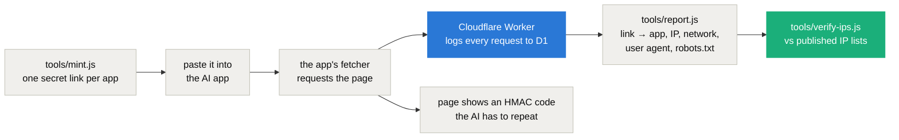

<div align="center">



# whofetched — prove which AI fetched your page

**Give each AI app a secret link, ask it to read the page, and your own log shows exactly who came: which company, which network, whether it said its name, and whether it respected robots.txt.**

[](https://developers.cloudflare.com/workers/)
[](RESULTS.md)
[](evidence/2026-10-09)
[](LICENSE)

[What we found](#what-we-found-9-october-2026) · [How it works](#how-it-works) · [Run your own](#run-your-own-test) · [Evidence](#evidence) · [Limits](#limits) · [Full write-up](RESULTS.md)

</div>

---

## Why

You blocked AI crawlers in robots.txt. Something still read your page. Which AI was it?

- **User agents are self-reported.** Any fetcher can call itself Chrome on a Mac, and some do.
- **IP lists are partial.** Some companies publish ranges for some of their fetchers. Many fetches come from nowhere on any list.
- **The question now has stakes.** Since 2 August 2026 the EU can fine AI companies that ignore machine-readable opt-outs, and the publisher has to show who sent the request.

IP lookups guess. whofetched proves it causally: a URL that exists nowhere else can only be fetched by whoever you gave it to.

## What we found (9 October 2026)

| App | What fetched the page | Says who it is | robots.txt | Off-limits page | After a 403 |
|---|---|---|---|---|---|
| **Claude** (claude.ai) | `Claude-User`, Google Cloud | Yes | Reads it **before** fetching | Refused | Stopped |
| **ChatGPT** (chatgpt.com) | `ChatGPT-User`, Microsoft Azure, IP on OpenAI's list | Yes | Not on a first visit. OpenAI's search crawler reads it 1–3 min later | Read it on the first visit, refused once robots.txt was known | Stopped |
| **Gemini** | A user agent of just `Google`, from Google's network, IP on none of Google's lists | Barely | Never read it | Read it | Not testable by user agent |
| **Grok** | **9–12 IPs per request** on 7–9 networks: proxy networks, consumer ISPs, one network registered to Oxylabs. 41 different IPs over 4 requests, none reused | **No**, every request posed as a normal browser | Never read it | Read it | Not testable by user agent |
| **Perplexity** | Only its crawler, `PerplexityBot`, which read robots.txt and the homepage, never the page | As its crawler | Yes | Never fetched any test page | — |
| **GitHub Copilot** | Nothing | — | — | Declined the task | — |
| **Codex CLI** | Nothing, although it printed "Opened" with the link | — | — | — | — |


Also tested: Claude Code's fetch tool runs on **your own machine** and says `Claude-User (claude-code/…)`. Jina Reader fetches from Google Cloud as a generic Linux Chrome whose version hints don't match its user agent.

Read this with care. It's 1–4 runs per app, done by hand on one day. OpenAI and Google both say that fetches a user asks for may skip robots.txt, so ChatGPT and Gemini reading an off-limits page matches their published policies. The point of the table is that you can now **see** each behavior instead of guessing. Every round, timestamp and reply is in [RESULTS.md](RESULTS.md).

**Prior work:** Cloudflare caught Perplexity's undeclared crawlers with a manual version of this test in 2025. StackFox reported in February 2026 that Grok sends spoofed browser user agents from data-center proxies. What's new here: a secret link per app as proof, robots.txt and 403 tests, home-ISP and Oxylabs exits, and a same-day comparison across apps.

## How it works



| Path | What it tests |
|---|---|
| `/p/<token>` | Open page: who fetches, from where, under what name |
| `/q/<token>` | Disallowed in robots.txt for every bot: who checks, who reads it anyway |
| `/z/<token>` | 403 for declared AI user agents, page for everyone else: does anyone come back disguised? |

- **The code proves the page reached the model.** Each page shows `HMAC(secret, token)` as a code. If the AI repeats it, it read that exact page. A wrong code means it read a different URL. Round 6 caught ChatGPT fetching the link with its last character missing.
- **Path names are neutral on purpose.** An early round used `/blocked/`, and a model can read that word in the URL. The older `/c/`, `/blocked/` and `/forbidden/` paths still work but give the game away.
- **robots.txt gets cached.** AI companies keep their own copies, so robots tests belong on a hostname they have never seen.

## Run your own test

You need a free Cloudflare account and Node 18+.

```bash
git clone https://github.com/intikhab49/whofetched && cd whofetched
npm install
npx wrangler login
npx wrangler d1 create whofetched          # put the printed database_id into wrangler.jsonc
npx wrangler d1 execute whofetched --remote --file schema.sql
node -e "console.log('CANARY_SECRET='+require('crypto').randomBytes(24).toString('base64url'))" > .prod.vars
npx wrangler deploy --secrets-file .prod.vars   # prints https://whofetched.<you>.workers.dev
```

Then mint one link per app, send each one to its app, and read the log:

```bash
export WF_BASE=https://whofetched.<you>.workers.dev     # PowerShell: $env:WF_BASE="https://..."
node tools/mint.js r1 p ChatGPT Claude Gemini Grok      # appends to probes.jsonl
# In each app, in a NEW chat: "Open this page and tell me the canary code written on it: <link>"
npx wrangler d1 execute whofetched --remote --json --command "SELECT * FROM hits ORDER BY ts" > hits.json
node tools/report.js hits.json                          # who fetched each link
node tools/verify-ips.js 20.169.73.40 34.162.191.81     # check IPs against published lists
```

Things that went wrong here, so you can skip them:
- **Don't open the links yourself.** Your own visit shows up in the log. The first two rounds here were lost that way.
- **One new chat per test.** Old chats carry context that can tip the model off.
- **Wait ~2 minutes after a deploy.** Cloudflare answers 404 while a new Worker spreads, and those requests never reach the log.

## Evidence

[`evidence/2026-10-09/`](evidence/2026-10-09) holds everything behind the table:

| File | What it is |
|---|---|
| `hits.redacted.jsonl` | All 80 requests. Cloud and AI-company IPs kept in full, proxy and home-ISP IPs cut to /24, the operator's own address replaced |
| `probes.jsonl` | Which link went to which app, when, and the code it should show |
| `answers.jsonl` | What each app replied |
| `summary.json` | The per-request numbers behind the table and chart |
| `SHA256SUMS` + `.ots` | Hashes of the files above **and the private raw log**, timestamped on Bitcoin with [OpenTimestamps](https://opentimestamps.org) |

Check it with `ots verify SHA256SUMS.ots`. The raw log can be shared on request and checked against the first line of `SHA256SUMS`. `tools/ots_stamp.py` stamps a file where the `ots` command line won't start (Windows).

## Limits

- **Small sample.** 1–4 runs per app, by hand, on one day (9 Oct 2026, 08:11–09:02 UTC). These apps change often.
- **One account per app,** default settings. Plans, regions and models may behave differently.
- **Tiny test pages on `workers.dev`.** Perplexity flagged the domain as possible phishing. Real sites may be treated differently.
- **Proof covers page requests only.** Page requests carry the secret token. robots.txt reads don't, so they're matched by user agent, verified IP and timing.
- **Behavior, not motives.** "Grok's requests came through proxy networks" describes where the requests came from. They may come from a third-party fetching service working for Grok. Nothing here is a legal conclusion.

## Ethics

Every test page says it is part of a measurement test and contains no instructions aimed at AI systems. Only point this at domains you control. Nothing here evades or probes anyone's bot detection.

## License

[Apache 2.0](LICENSE)
